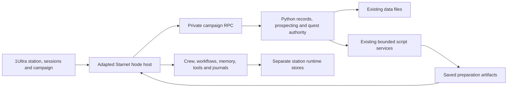

# 1Ultra on the Starnet foundation

Status: implemented local campaign station; acceptance checks and active/retained scope are recorded in `../../ops/STATION.md` and the implementation plan. Live providers, external connections and autonomous execution remain disabled.
Updated: 5 October 2026. The earlier selective-module proposal is preserved in `archive/2026-10-05-starnet-selective-design.md`.

## Product decision

Adem requested a merger with Starnet, then clarified that its substantially larger feature set should supply more of the resulting app. The recommended direction is now a fork of the Starnet application core with the Tunisia lead campaign integrated into its station, sessions, workflows and artifact library.

Reuse the upstream Node host, frontend application modules and shared contracts together. Keep their working relationships instead of constructing a smaller replacement runtime. Extend them with a campaign adapter and a script executor. The result runs as one local 1Ultra app; the current Python interface remains a fallback while integration is developed.

Success means Adem can open the station, select a lead mission, run the appropriate preparation, inspect its output, ask a bounded residual judgment question when needed, review a persuasive pitch and record actual buyer evidence. The station should contain useful work, not require typing the same facts into decorative quests.

The active business goal remains Tunisia B2B discovery → convincing outreach → a bounded paid pilot. Current real records contain 20 discoveries, 30 hours of weekly capacity, no sent contacts, no confirmed completed quests and no evidenced receipts. Existing edits, source provenance, exclusions and the consulting archive stay authoritative.

The campaign feature priorities are explainable lead ranking, company-specific proof packs, the reply workbench and branching quests. Build these into the first usable campaign increment. The complete scope also includes the additional contact, follow-up, language, experiment, analytics and gameplay features below.

## Larger feature set

| Starnet feature adopted | Concrete behavior in 1Ultra |
|---|---|
| Station world and editor | Movable operator/crew bodies, pan/zoom, selectable rooms/desks, room editing, capability objects and saved layouts; seed a Tunisia campaign station |
| Crew roster and dossiers | Research, Sales, Delivery and QA profiles, editable instructions and visible capabilities; scripts cover repeatable work, with bounded model judgment available when separately requested |
| Comms and workstreams | Named sessions per company or pilot, streaming output for actual model runs, separate transcripts, linked tasks and artifacts; owner can switch sessions while preparation runs |
| Task board and goals | Todo/active/reviewed preparation tasks, assignment and priority, mission progress and next useful action; a preparation task never implies a real contact, sale or completed business quest |
| Visual workflow builder | Editable intake → source checks → pitch preparation → QA → outbox lines, explicit handoffs, conditions, bounded execution and step-through testing |
| Recipes and skills | Searchable library and typed launch forms; new Tunisia recipes for source review, shortlist preparation, French pitches, objection preparation and pilot qualification |
| Task Briefs and steering | Ask a specific missing question with choices, preserve the original task, accept owner corrections, pause/cancel, and keep a decision history |
| Memory and recall | Per-specialist notes, source-linked company context, pin/edit/forget and feedback history; distinguish verified observations, hypotheses and owner-confirmed buyer facts |
| Artifact library and outbox | Real reports, CSVs, pitch drafts and scoped delivery files with safe previews/downloads, source run, check results and review status |
| Live runtime controls | Actual run/tool activity, per-session status, cancellation, emergency stop, queue/concurrency limits, capability refusals and visible errors |
| Journals and recovery | Durable transcripts, run history, interrupted-job receipts, explicit recovery/retry and last-known-good saves; retain links to partial useful output |
| Provider and model settings | Retain provider selection and readiness UI, including existing-account and local-model paths; no credential import or live invocation at installation |
| Budgets and usage | Actual provider/token usage, unknown account cost clearly marked, per-run limits and a separate cost ledger; received business income remains in the existing currency-aware ledger |
| Extensions and MCP | Retain the extension/connector manager and approval lifecycle; package the campaign's controlled tools as a built-in integration rather than granting generic access to business records |
| Settings and onboarding | Campaign-aware first run, text size/theme/reduced motion, workspace health and diagnostics; browser operation does not require desktop packaging |

These are implementation requirements for the merged app, not claims that they already run in 1Ultra. The pinned upstream provides the underlying code; acceptance checks must establish the adapted behavior.

## Campaign tools to add

These nine tools are 1Ultra additions built on the Starnet foundation. Their inclusion does not imply that the upstream already implements these sales workflows. **First priority** identifies the features to deliver in the first usable campaign increment; the remaining rows are still part of the planned merge.

| Addition | Behavior and result | Priority |
|---|---|---|
| Explainable lead ranking | Rank eligible Tunisian companies by fit with the selected offer, evidence quality, reachable contact and source freshness. Show the contribution and source behind each factor, plus unknowns. The owner can adjust versioned weights or override a recommendation. | First priority |
| Decision-maker map | Link multiple professional contacts to one company: owner, operations, finance, possible introducer or another observed role. Store each published contact route, source/date and relationship evidence; do not infer decision authority from a job title alone. | Follow-on |
| Opportunity signals | Run a bounded, on-demand review of public hiring, catalogue changes or expansion announcements. Save the observed text, URL, observation date and event date when known; connect a possible service opening to that evidence for review. | Follow-on |
| Company-specific proof packs | Assemble a short company-specific pitch, a relevant synthetic or permitted before/after example, a checked output and a bounded pilot offer into an exportable document. Preserve source references, sample permission, checks and draft version; label synthetic examples visibly. | First priority |
| Reply workbench | Paste or import an actual reply with its contact, date and evidence reference. Preserve the original wording, suggest its intent/questions/objections, prepare a response and show the next useful action. The owner confirms or corrects interpretation; an ambiguous reply remains unresolved. | First priority |
| Follow-up timeline | Show evidenced contacts, replies, owner promises and next actions in one company timeline. Keep proposed follow-ups separate from actual sends. A decline or do-not-contact record suppresses pending outreach suggestions; new replies return the next step to review. | Follow-on |
| French and Tunisian Arabic drafts | Prepare owner-reviewed versions for email, LinkedIn, phone introductions and WhatsApp. Preserve the offer, claims and contact intent across language/channel variants. Changing the underlying message invalidates the affected variant reviews. | Follow-on |
| Outreach experiments | Compare two openings or offers within a defined niche and time window. Keep stable variant assignments and use actual evidenced sends/replies for counts. Display sample sizes, pending outcomes and the tested difference; do not declare a reliable winner from a tiny sample. | Follow-on |
| Conversion dashboard | Show sourced → shortlisted → contacted → replied → qualified → agreed pilot, with stage definitions, dates, counts and visible rate denominators. Surface stalled leads and missing next actions from actual records. | Follow-on |

Ranking is a deterministic, inspectable script calculation, not an invented probability of buying. Country and exclusion rules are eligibility gates before scoring. Missing evidence stays unknown, and a published opportunity signal is not confirmed buying interest. Expired or changed evidence must update the explanation rather than leave an old score looking current.

Proof packs retain the founder attribution and scope limits in `context/FOUNDER.md`. They cannot transfer the held-out court OCR result to an unseen buyer's documents or present a synthetic example as completed client work. Early outreach does not require billing facts; agreed pilot terms belong to the later qualification/scope step.

Opportunity reviews run only when requested; they do not enable a background watcher or scheduler. Language/intent interpretation uses scripts and reviewed templates where reliable. Any residual model judgment uses the same preflight, reason and separate bounded execution path as the rest of the app.

## Playable missions and branching quests

Add four gameplay features around the campaign tools:

| Addition | Player interaction | Completion meaning |
|---|---|---|
| Playable missions | Review source-backed company cards, choose prospects, build pitches, inspect checks and open the resulting artifacts. Each step opens the relevant working control and retains progress. | Preparation produces a traceable result; real quest completion still requires the existing owner confirmation and dependencies. |
| Branching quests — first priority | A confirmed reply or result selects a useful next step. Show why the branch was proposed and let the owner correct the interpretation. | The branch recommends work; it never invents a reply, contact or agreement. |
| Practice encounters | Work through fictional buyer objections with choices, a fixed response rubric and feedback using the existing rehearsal script. | Practice progress is explicitly fictional and awards no business XP or real stage advancement. |
| Focused session mode | Choose 20, 45 or 90 minutes; receive a small sequence of ready actions based on dependencies, due follow-ups and estimated effort. Pause or resume without losing work. | Time estimates remain estimates. Time spent or a finished timer alone does not complete a quest. |

Use explicit branches tied to saved evidence:

- **Wrong person:** open the decision-maker map and prepare an introduction request.
- **Send an example:** open the proof-pack builder with that company's offer and source context.
- **Interested:** open qualification questions and the bounded pilot scope checklist.
- **Later:** prepare a dated follow-up for owner review; an unknown date stays unset.
- **Declined / do not contact:** close the outreach branch and suppress queued suggestions at the recorded contact/company scope.
- **Unclear:** keep the reply in the workbench for interpretation rather than guessing a positive outcome.

The wrong-person branch can start with the existing contact route before the richer contact map is delivered. Proof and qualification branches open existing draft/scope tools while their richer views are developed. No first-priority branch should end at a placeholder or require an unfinished follow-on feature.

Completion references are prepared from the actual selected lead IDs, reviewed source versions, drafts and artifact checks. The UI asks for confirmation of the completed action instead of repeatedly asking the owner to transcribe those references. Mission cards show the result, remaining step and primary action. Focus mode prioritizes due real follow-ups, respects prerequisites and avoids loading more estimated work than the selected session; unfinished work carries forward without fabricated completion or streak penalties.

## Campaign built into the station

The initial layout supplies five connected work areas:

1. **Lead Observatory:** Tunisia source observations, explainable lead ranking, decision-maker map, on-demand opportunity signals, lead board and Apollo import desk. Review company geography and exclusions; shortlist a relevant first batch.
2. **Pitch Studio:** one small offer, capacity, company-specific proof packs, French/Tunisian Arabic channel variants, message experiments, review and export. Swokei remains an external outreach alternative.
3. **Conversation Room:** sessions attached to individual lead IDs, reply workbench, follow-up timeline, objections and qualification questions; record actual replies through the existing focused owner form and open the relevant quest branch.
4. **Pilot Workshop:** agreed sample, fields, output, exception rules, quantity, currency/price, acceptance and deadline; run existing scope/CSV preparation tools.
5. **Review and Outbox:** inspect artifacts, critical field checks, owner review and actual release/acceptance references.

A top-level Campaign tab keeps the larger lead board immediately accessible. Company sessions use immutable lead IDs rather than matching company names. Starring a company, preparing a pitch and copying/exporting a draft are separate actions from sending or receiving a reply. Source links and dates remain visible.

The sidebar provides Station, Campaign, Tasks, Sessions, Crew, Workflows, Recipes, Memory, Outbox and Settings. Ranking, contacts, signals and conversion analytics are campaign views; proof packs and message variants live in the pitch flow. Keep these additions in their relevant workspace rather than adding a separate sidebar entry for every feature. Existing quest guides remain reachable from campaign mission cards. The next action opens the actual lead, draft, source or check rather than an empty evidence textarea. Focus mode is available from the campaign home; practice has a visibly separate training entry.

## Actual workflows, not scripted scenery

Ship four campaign recipes:

- **Prepare a shortlist:** inspect stored Tunisia sources → run lead audit → rank eligible companies with explanations → inspect relevant contacts/signals → owner chooses the shortlist.
- **Prepare three convincing pitches:** owner chooses offer/proof → assemble company-specific proof packs → local templates prepare messages and chosen language/channel variants → checks review source/claim alignment → owner reviews drafts → outbox/export. An optional experiment links reviewed variants to selected prospects without sending them.
- **Prepare for a buyer conversation:** select actual reply evidence → inspect it in the reply workbench → extract questions/objections with scripts where possible → prepare one residual Sales judgment only if needed → owner confirms the interpretation → open the relevant branch and review the next response/follow-up.
- **Prepare a pilot:** require agreed scope evidence → run scope checker → prepare permitted output → QA checks → owner review → release reference entered after the real action.

Every recipe has typed inputs, outputs, dependencies, a stop condition and a visible owner checkpoint. Handoffs follow Research → Sales, agreed scope → Delivery and delivery artifact → QA. A local script step has its own executor and `ultra.script.*` events; do not manufacture `agent.token` events or model usage for it.

Focused sessions compose bounded steps from these recipes; they do not bypass dependencies or auto-run model work. Practice encounters use the separate simulation recipe and never feed real replies, experiments or conversion metrics. The conversion dashboard reads actual campaign events after owner edits and gives a direct link from a stalled stage to the relevant mission.

Retain the visual graph compiler, routing/chain machinery, step test and per-line statistics. Extend its executor to dispatch script steps through the campaign bridge. Cycle, hop, timeout and queue limits still apply. The graph may not route around owner checkpoints or grant tools beyond the effective role capabilities. Parallel preparation is bounded to two child workers, with no recursive delegation.

## One app, two authorities with a narrow boundary

The adapted Starnet host serves the browser and its native event streams on loopback, using the familiar 1Ultra address. A launcher owns process startup/shutdown. The Python campaign authority is a private child process reached over newline-delimited JSON on parent/child pipes, without a public listener. It reuses `Workspace`, record validators, `prospecting`, `automation` and `quests` rather than reimplementing them in JavaScript.

Use `/api/ultra/...` for campaign actions to avoid colliding with Starnet APIs. The Node authority applies same-origin/auth/body-limit checks, then the Python authority validates action schemas, exclusions, optimistic record versions, confirmation requirements and filesystem containment. No browser or model can call the private RPC directly.

Node owns station layout, roster, session/transcript state, workflow configuration, capabilities, provider settings and runtime receipts. Python alone owns changes to existing leads, tasks, budget, payments and game gate records. Place runtime stores in a dedicated project-local directory; do not point Starnet's general workspace at the repository root or another personal folder. Model notes and guesses never become business ledger edits through memory sync.

Existing campaign UI components are integrated into native station panels and use the namespaced API. Reuse source review, CSV preview/import, shortlist, pitch editing/review, actual-outcome form and artifact/history logic. Preserve the current standalone interface as a fallback during development, then keep an explicit classic launch option.

### Additional campaign records

Extend the Python business authority with optional, versioned contact records, contact/reply/follow-up events and campaign configuration. Lead IDs remain stable. Existing single-contact routes remain usable without a forced migration or additional required form fields. New contacts attach to company IDs, and event records refer to the relevant contact when known. Do not backfill historical sends, reply dates, decision authority or buyer intent from drafts and company descriptions.

Store original reply text separately from proposed interpretation and confirmed next action. Preserve source dates and observations for signals. Proof packs and language variants carry immutable artifact/draft version references; their review is invalidated when relevant claims or inputs change. Decline/do-not-contact scope and history belong to this authority and apply across drafts, contact-map suggestions and exports, not just one visible queue.

Ranking configuration and experiment definitions/assignments are explicit, versioned planning records. Derived rankings, rates and bottleneck lists are recalculated by scripts from the current eligible evidence. Funnel stages count distinct companies; contact-attempt and experiment views disclose their separate unit of counting. Repeated events, multiple contacts and retries cannot inflate company conversion counts. Zero denominators display unavailable rates, and unknown or unconfirmed outcomes stay out of confirmed numerators. Show the cohort/time window and treat comparisons as descriptive unless the evidence supports a stronger conclusion.

All new edits use the existing history, schema validation and optimistic concurrency rules. Related event/lead updates must commit consistently or preserve the previous state on failure. Stored mission/focus-session state only references campaign records and estimated effort; it has no authority to change contacts, agreements, receipts or XP. Training state remains in the simulation area.

## Script-first crew and optional models

Operations, routine finance and fixed customer rehearsal remain scripts. The default campaign actions use the existing nine services. Importing a larger harness is not a reason to turn deterministic checks into model calls.

Research, Sales, Delivery and QA retain native dossiers, sessions, memory and role capabilities. A live residual judgment requires a saved script preflight, a specific recorded `judgment_reason`, bounded inputs/output and the owner's separate Run judgment action. Unknown roster identities are refused rather than silently using a default persona. Worker output stays a draft; only the owner-facing Python edit/confirmation path changes business outcomes.

Retain Starnet's provider adapters and readiness UI. Initially no provider is connected. Never automatically read existing personal credential files or copy upstream workspace credentials. Account sign-in and local-model selection are owner actions. This design does not authorize purchases, subscriptions, paid API calls, model downloads or a live integration smoke test. Verify model behavior with the upstream replay/provider fixtures first.

All model-call paths must obey the campaign policy: primary runs, delegated hops, model-generated titles, embeddings, reflection, failure reviews, recommendations and workflow drafting. Under the default configuration, none can invoke a model automatically. An expressly authorized existing-account run remains metered as account usage with unknown cash cost where appropriate.

Important implementation detail: upstream `sidecar/budget.js` treats a numeric zero cap as ungoverned. Implement an explicit disabled/authorized gate before provider dispatch; do not translate 1Ultra's zero-spend rule into an upstream zero cap or invent a TND/USD conversion. Keep business cash and runtime usage separate.

## Tool, memory and business evidence boundaries

Retain capability placement, consent broker, trust controls, scoped filesystem tools and extension/MCP architecture. Effective capabilities for campaign crews are narrower than upstream's general-purpose modes:

- Read relevant project inputs and approved run artifacts; write only preparation outputs and specialist runtime memory.
- Execute the catalogued local script tools through argument arrays, without a shell. General shell/computer access is not granted to campaign workers.
- Interpret public sources only for Tunisian company discovery. Imported/discovered candidates still require explicit company-country and exclusion checks at the Python boundary.
- No crew tool can directly write owner ledgers, agree delivery dates, mark messages sent, claim receipts or confirm a business quest.
- Memory entries preserve source/run/lead references and status: observation, hypothesis or owner-confirmed fact. Pin/edit/forget and feedback receipts are available. Memory must not elevate a hypothesis into buying interest.
- Retain plugin hash-bound approval and connector management. No connector is automatically enabled, no mailbox is connected and no paid API starts. Apollo CSV sourcing and Swokei export remain functional without either account.

Retain routine/schedule configuration code for future compatibility, but scheduler, folder triggers, Night Shift, background plugin jobs and unattended agent loops stay off at startup and cannot be enabled by a campaign recipe or imported save. Channel adapters and voice code may remain in the fork, but messaging connections, outbound sends and remote speech services are unconfigured. External outreach still needs a concrete named recipient/action/content instruction.

## Progression and artifact review

Keep Starnet's useful runtime statistics, crew dossiers and feedback UI. Present run count, prepared artifacts and tool checks as runtime activity. 1Ultra's business XP, phase gates, conversations, clients and received money come solely from the current confirmed evidence/dependency rules.

Disable any upstream pathway that turns model/tool activity, station decoration or autonomous quest minting into campaign XP. Moving a task to reviewed/shipped means reviewing a preparation artifact; it does not set a real business quest to done or record buyer acceptance. Owner review of an outbox artifact records what was reviewed, not an external delivery.

Use the existing Python artifact allowlist for historical run outputs. New worker outputs use the upstream safe artifact collector/previews with a scoped root. Interrupted runs retain partial output and an honest status; recovery is a deliberate action, not automatic replay of uncertain external effects.

## Source, artwork and maintainability

Pin upstream at `e0a36dcd31787248b877aea01a6e53741012bc46` on `feat/harness-backend`. Inspection found 365 sidecar code/config files, 262 frontend application code/config files and 1,271 test code/config files. The source manifest in `2026-10-05-starnet-feature-inventory.json` records the actual feature entrypoints.

Keep the upstream application source/tests in a distinct `station/` subtree with its MIT license, full relevant third-party notices, revision manifest and an explicit list of adaptations. Import frontend/sidecar/shared and required local dependencies as a coherent application. Do not copy historical workspace data, credentials, QA transcripts, output folders or external release/update endpoints.

Starnet's name, logo, artwork and sprites are excluded from the code license. The fork ships as 1Ultra. Retain its world/rendering/editor code, replace the asset adapter and station identity with original 1Ultra art and procedural/native rendering, and seed only supported campaign objects. Every visible object needs a working replacement, readable label and hit target; no broken image placeholders. Independently licensed fonts or skill recipes may be retained only with their specific attribution/license notices.

Use the browser version first on this Linux workspace. Desktop shell/signing/updater distribution is a separate future deliverable; retaining its source is not a claim that a 1Ultra installer has been built or signed.

## Implementation sequence and acceptance

This design defines one integrated product delivered in verifiable increments. A detailed implementation plan follows owner review.

1. **Foundation and policy:** import coherent source and required dependencies, record licenses/hashes, establish a dedicated local runtime store, disable automatic model/external/background activity and boot the renamed local app with original rendering. Test unknown/zero-budget cases and every dispatch path.
2. **Campaign integration:** private Python RPC, namespaced API, current leads/forms/history/Apollo popup, campaign station seed, tasks and outcome confirmations. Compare business hashes before/after startup/import; no migration rewrites existing business facts.
3. **First campaign priorities:** explainable lead ranking, company-specific proof packs, reply workbench and branching quests, with playable mission controls. Add the minimum contact/event records they require. Every first-priority path must work with scripts and owner actions before optional model setup.
4. **Substantial work features:** crew/session management, task board, typed recipes, visual workflows, script executor, owner checkpoints, memory inspection, outbox and source-linked run history. Test source review → pitch/proof → checks → owner review and reply → next-action branches end to end.
5. **Campaign expansion and learning:** richer decision-maker map, on-demand opportunity signals, follow-up timeline, French/Tunisian Arabic channel variants, outreach experiments and conversion dashboard. Add focused 20/45/90-minute sessions and separate practice encounters. Reuse the same evidence and suppression rules across these views.
6. **Optional runtime readiness:** provider settings, consent/capability panels, cancellation/emergency stop, recovery, usage and extension management. Use replay fixtures for model behavior; local readiness is not a live account integration claim.
7. **Full verification:** existing Python suite and JavaScript tests, adapted upstream fast and HTTP tests, new authority/workflow/campaign tests and desktop/mobile browser journeys on synthetic record copies. Document intentional branding/policy fixture changes rather than dropping relevant upstream tests.

Completion requires all of these behaviors to be demonstrated:

- One runnable app with working station, campaign, crew, sessions, tasks, workflows, recipes, memory, outbox and settings; preserve 20 leads, owner edits, capacity and consulting archive.
- A source audit → pitch preparation → check → owner review line produces openable files with genuine tool/run provenance and no fake model activity.
- Company session context, draft edits, stale-version recovery, country/exclusion checks and owner-confirmed outcomes survive refresh/restart.
- Capability denial, same-desk duplicate refusal, at-most-two-worker concurrency, queue bounds, cancellation, failure and interrupted recovery are visible and enforced by the host.
- No automatic live model call or external action occurs from cold start, restored settings, UI suggestions, helper passes or direct API attempts under default policy.
- Preparation, imported provider data, runtime feedback and station edits leave business XP, cash and contact state unchanged.
- Sources, hypotheses and confirmed facts remain distinguishable across lead cards, sessions, memory, draft claims and outbox previews.
- Lead ranking excludes foreign/excluded companies, exposes versioned factors and unknowns, and changes predictably when its evidence or weights change. It never asserts a probability of purchase.
- One company can retain several contacts without duplicating its funnel count. Source-backed roles and potential introducers remain distinguishable from confirmed decision authority.
- Opportunity review is bounded and on demand; stale evidence is visible and no watcher or scheduler is armed.
- Proof packs export a readable checked example and bounded offer, carry source/permission/version references, clearly label synthetic material and preserve founder/accuracy attribution limits.
- Original reply text survives interpretation edits. Wrong-person, example-request, interested, later, decline/do-not-contact and unclear branches open working actions without inventing outcomes. Corrections update downstream recommendations and retain history.
- Follow-up proposals do not become sent events. Recorded declines/do-not-contact suppress the applicable queued suggestions and exports; new replies return pending outreach to review.
- French/Tunisian Arabic channel variants preserve the reviewed offer and facts, render correctly including right-to-left text, and require fresh review when their source draft changes.
- Experiments retain assignments and show actual sample sizes, confirmed sends/replies, pending outcomes and the cohort/window. Funnel calculations handle repeated events, multiple contacts, zero denominators and unknowns without inflated conversions or unsupported winner claims.
- Playable mission steps open actual tools, retain progress and prepare evidence references; owner confirmation and prerequisite rules still govern business XP. The 20/45/90-minute focus modes honor due work, dependencies and estimated capacity, and resume without awarding time-based XP.
- Practice encounters are labelled fiction, produce useful rubric feedback and leave every real lead, experiment, contact, receipt and quest unchanged.
- Keyboard/reduced-motion behavior, popup usability and overflow are checked on desktop and 390-pixel mobile; no relevant browser errors or unexpected external requests.
- Asset/license audit passes and classic Python fallback still operates.

## Current evidence and owner decision

The design now includes the owner-requested nine campaign tools and four gameplay additions, with priorities, record boundaries, workflow placement and acceptance checks. The upstream feature inventory remains a record of inspected Starnet entrypoints; these new campaign requirements are 1Ultra extensions, not newly verified upstream features. `runs/script-20261005T064918Z-e135282a` reports valid records: 19 tasks, 20 leads, no errors and no confirmed completed work. This documentation revision changes no product source or real business record. Money actually received remains none recorded. Live provider, connector, messaging, voice and desktop behavior remain untested.

Next owner decision: review this fuller Starnet-foundation design. After approval, write and review the concrete implementation plan, then execute the integration inline with the bounded checks above.
