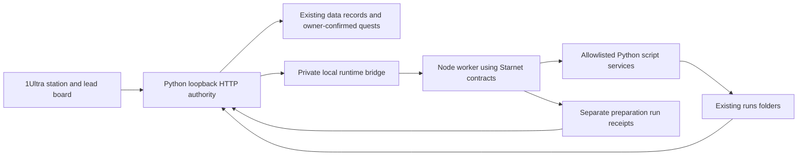

# 1Ultra × Starnet merge design

Status: proposed design for owner review. Product implementation has not started.

## Intended result

Adem asked to merge the Tunisia lead game with `https://github.com/androoAGI/starnet`. The proposed result is one 1Ultra app: a station whose desks launch useful local preparation, with the existing lead board and guided quests available from those desks. The business objective remains finding Tunisian B2B companies and convincing them to discuss a bounded paid pilot.

The working assumption is a combined workflow and runtime, rather than only a visual restyle or moving all records into a separate Starnet installation. An optional preference question was presented during inspection; an unanswered preference is not design approval.

The existing 20 discoveries, owner edits, exclusions, archived consulting payment, 30-hour weekly capacity, receipt rules and evidence-derived XP remain authoritative. Script activity must never look like a real buyer reply or completed business quest.

## Approaches considered

| Approach | Benefit | Tradeoff |
|---|---|---|
| Selective code merge — recommended | Actual reuse of station geometry and runtime contracts, connected to the existing campaign and scripts | Needs a small adapter between Node runtime modules and the Python business authority |
| Full Starnet fork | Retains its broader agent/provider/desktop product | Imports a much larger application and needs replacement of excluded branding/artwork; most features do not serve the current campaign |
| 1Ultra Starnet plugin | Provides a campaign window inside a separately installed Starnet | Requires a second installation, hash-bound plugin approval and an additional bridge to the Python records; station remains the upstream product |

## Upstream provenance and reuse boundary

Inspection was pinned to commit `e0a36dcd31787248b877aea01a6e53741012bc46`, dated 4 October 2026, from upstream's `feat/harness-backend` branch. The public source was downloaded for inspection into `/tmp`; no upstream executable was launched.

Reuse these modules, preserving attribution and a manifest of original hashes and local adaptations:

| Upstream source | Use in 1Ultra |
|---|---|
| `frontend/app/worldmodel.js` | Serializable station rooms and desks, geometry and layout bounds |
| `shared/schema.js`, `shared/events.js`, `shared/emitter.js` | Payload validation; preserve upstream events and add explicitly named `ultra.*` preparation events through an adapter |
| `sidecar/capability/capGate.js` | Enforce the allowed script set for each desk; delegated subsets can only narrow it |
| `sidecar/concurrency.js` | Bound distinct active desk workers; supplement with one job per desk because upstream permits repeated entries for the same identity |
| `sidecar/runstore.js` | Local run receipts and artifact links, never business completion; adapt its `failopen.js` dependency to a small local error reporter rather than importing the complete context/provider system |

The upstream MIT notice must accompany reused code. Its `NOTICE.md` expressly excludes the StarNet name, logo, station art, sprites and other brand identity from that license. Use the 1Ultra name and existing original/generated art, plus native canvas/CSS desk shapes. Do not ship upstream sprites, fonts or bundled skill recipes in this merge. Existing 1Ultra art is independent of the upstream asset library.

Do not import the monolithic `sidecar/index.js`, desktop updater, provider credentials, channels, schedulers, background agent loops, payment systems or external connector configuration. The runtime being merged in this phase prepares local artifacts. The existing bounded Codex judgment CLI remains available separately; no model executes from the website.

## Architecture and authority

Keep the existing browser address and startup command. The Python server launches one local Node child when Node 18+ is available. Python remains the sole authority for record edits, CSRF protection, optimistic versions, exclusions, country filtering, receipt validation and quest progress. The Node host accepts a private newline-delimited request protocol over parent/child pipes; it exposes no public HTTP listener or model endpoint.

The bridge accepts a fixed action envelope: request ID, desk ID, catalog tool ID and validated parameters. It rejects arbitrary commands, executable paths, project roots, provider keys and execution flags. Each job launches only the existing `scripts/ultra.py script TOOL` command with arguments passed as an array and no shell. Use the project root selected by the parent, a minimal child environment and a bounded timeout. Do not inherit provider secrets or unrelated environment credentials.

Initially allow one job per desk, at most two distinct desks and a bounded waiting queue of eight jobs. Idempotency keys prevent duplicate starts when a browser retries. Persist admission and terminal state in a separate local preparation store under `runs/station/`; on restart, unfinished jobs become interrupted and need explicit retry. Never automatically rerun them.

The upstream concurrency gate counts identities, not all jobs; the host must therefore enforce the additional per-desk rule. Capability checks run in the Node host, not just on visible buttons. Python validates parameters again before running the script. The bridge reads back the resulting `run.json` and approved artifact paths before reporting success.

If Node is missing or the child fails, show that the station runtime is unavailable and retain the existing Python workshop. Do not fabricate an idle/working/success state from animations. Errors remain visible with a retry action. Business records are unaffected by child termination.

## Station and campaign experience

Add a Station route beside Lead hunt. It presents five connected work areas using Starnet's station model and a 1Ultra renderer:

1. **Scout desk:** sourced Tunisia discoveries, shortlist, local lead audit and Apollo/Swokei sourcing popup.
2. **Pitch desk:** opening offer, source-specific French pitches, draft review and local outreach-draft artifacts.
3. **Conversation desk:** the current lead board and focused owner outcome form; actual contacts and replies remain manually evidenced.
4. **Delivery bench:** agreed scope checker, CSV workbench and source/output acceptance references.
5. **QA desk:** record validation, saved artifacts and clear links to owner review requirements.

Desk labels and controls distinguish local script preparation from residual judgment roles. No animated character is described as a live model agent unless a real model run exists. Model usage stays disabled in this phase. Operations and finance remain scripts; their retired agent definitions remain retired.

Clicking a desk opens the existing useful workflow or a native run panel. Show queued/running/prepared/failed/interrupted states from host receipts, the actual tool, elapsed time, output reference and next owner action. A prepared script report is labelled prepared, even when its process exited successfully. The station links back to the larger lead board and does not force map navigation for common actions.

Persist cosmetic position/zoom independently of real campaign state. Honor reduced motion; desk actions must be keyboard accessible, have readable text labels and fit mobile layouts. Layout changes must never grant business XP or bypass quest dependencies. Quest gates continue to come from `quests.progress` and existing owner-confirmed evidence.

## File responsibilities

- `vendor/starnet/`: selected code, MIT notice and commit/hash manifest; no upstream artwork.
- `runtime/`: Node host, capability catalog, event adapter, bounded job state and run-store dependency adapter.
- `scripts/station_runtime.py`: child lifecycle, request validation, timeout handling and snapshot adapter.
- `scripts/ultra_ui.py`: existing HTTP boundary plus station preparation/status actions.
- `web/station.js`, `web/station.css`: station renderer, accessible desks and real preparation status.
- Existing hunt, quest, record and artifact components: reuse their current actions; preserve same-origin request handling and optimistic record versions.
- `tests/`: runtime unit/contract tests, Python HTTP/bridge failure tests and rendered workflow checks.
- `docs/ops/STARNET_MERGE.md`: startup, exact imported modules, limits, troubleshooting and removal path.

No migration rewrites `data/leads.json`, `tasks.json`, `payments.json`, `budget.json` or `game.json`. The new preparation store is separate. Removing the runtime modules restores the existing Python-only app.

## Acceptance checks

1. Start from the current Python command and open one working 1Ultra browser app. Verify 20 existing Tunisia leads, current owner edits/capacity and the recoverable consulting archive.
2. Each desk launches its allowed script or opens its relevant existing campaign action. An unknown tool, wrong desk, arbitrary command/path, malformed payload or execution flag is rejected server-side.
3. A visible running state corresponds to an admitted host job. Queue limits, same-desk duplicate refusal, idempotent retries, timeout, child failure and restart interruption behave as specified.
4. A finished preparation exposes only readable approved artifacts and its actual tool/run provenance. No model, external message, scheduler, receipt or quest completion is asserted.
5. Compare record hashes and cash/XP before and after all runtime tests: preparation alone cannot alter real records or progress. Script-safe CLI tools remain independently usable.
6. Verify Apollo import preview, country/exclusion filtering, shortlist, French pitch edit/review, stale-edit recovery, owner outcome evidence and boss prerequisites still work.
7. Run the full Python suite, existing JavaScript view tests and Node runtime/contract tests. Test desktop and 390-pixel mobile interactions with synthetic record copies, inspect screenshots, and confirm no relevant browser errors or unexpected external requests.
8. Validate the upstream manifest hashes, retained license and absence of copied upstream brand/art assets.

## Inspection evidence and next decision

The local `daily-pack` preflight completed in `runs/script-20261005T063909Z-90442318`. It still reports source review and offer selection as the next real actions, no confirmed completed work and no evidenced receipts. The inspected station model, capability, schema/event files and upstream host passed syntax-only `node --check`; this does not establish a working integration.

No business fact changed, so `STATE.md` was not updated. Money actually received remains none recorded. Starnet providers, account connections, desktop packaging and live model behavior remain untested and outside this implementation phase.

Next owner decision: approve this combined station/runtime design, or choose the full fork/plugin approach before an implementation plan and product changes.
